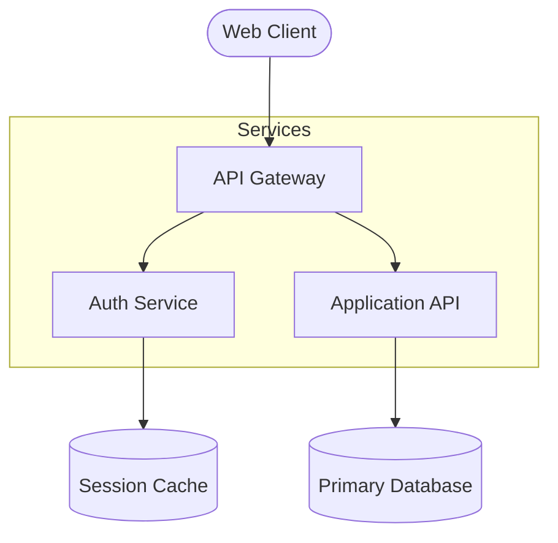

<p align="center">
  
</p>

<h1 align="center">Kurapika</h1>

<p align="center">
  An interactive Mermaid workspace for developers, security engineers and security architects.<br>
  Render diagrams in your browser, focus on connected nodes and explore complex flows.
</p>

<p align="center">
  <a href="https://github.com/0xdhanesh/Kurapika/actions/workflows/pages.yml"></a>
  
  
  
  
</p>

<p align="center">
  <a href="https://0xdhanesh.github.io/Kurapika/">Open Kurapika</a>
  &nbsp;·&nbsp;
  <a href="#run-locally">Run locally</a>
</p>

---

## Features

- Mermaid source editor with line numbers, syntax highlighting, and explicit rendering.
- Node inspection for flowcharts, including nested subgraphs. Selecting a node centers and enlarges it, highlights its immediate incoming and outgoing connections, animates connected paths, and dims unrelated nodes.
- Forward and backward tracing across multiple flowchart edges, with per-node source references and notes.
- Zoom controls, fit-to-view, and a full-width preview when the source editor is hidden.
- Light and dark themes. Dark mode uses terminal-green selection outlines and animated paths, with translucent gray subgraph backgrounds.
- SVG export and source copying.
- Service architecture, access decision, and sequence diagram examples.
- Responsive layouts and keyboard controls. Animation respects the browser's reduced-motion preference.

Mermaid diagram types can be rendered using the bundled library. Interactive inspection depends on the node and edge metadata exposed by each renderer. Flowcharts are the primary supported inspection format.

## Run locally

Use Node.js 22 or newer, npm, Python 3, and a modern browser.

```sh
git clone https://github.com/0xdhanesh/Kurapika.git
cd Kurapika
npm ci --ignore-scripts
npm run build
npm start
```

Open http://127.0.0.1:4173/. Stop the server with Ctrl+C.

The build copies the application and Mermaid's browser modules into `dist/`. Run `npm run build` after editing source files, then refresh the browser. Any static HTTP server can serve `dist/`.

## Use the workspace

1. Paste Mermaid code into the source editor or select an example.
2. Click **Render**, or press **Cmd+Enter** on macOS or **Ctrl+Enter** on other platforms.
3. Click a flowchart node to focus on it and its immediate connections. Keyboard users can focus a node and press **Enter** or **Space**.
4. Use **Hide source** to expand the preview. Use the zoom controls to adjust the view.
5. Click the selected node again, click empty canvas space, press **Escape**, or choose **Back to overview** to clear selection. **Fit diagram** also returns to the overview.
6. Use the theme button beside **Syntax guide** to switch palettes. **Export SVG** downloads the last successfully rendered diagram.

For example, paste the following into the editor.



Selecting **API Gateway** highlights Web Client, Auth Service, and Application API. Choose **Forward · downstream** to also follow both service branches to Session Cache and Primary Database. Choose **Backward · upstream** to see the path from Web Client.

With a node selected, open **Node references and notes**. Enter one file reference per line (for example, `src/router.js:42`) and add freeform notes. Edits update the Mermaid source as you type. **Copy source** carries these comments with the diagram. They are associated with the Mermaid node ID, so changing a display label preserves its notes. Clear both fields to remove the annotation.

## Local processing and storage

Diagram parsing and rendering happen in the browser. The application serves its Mermaid dependency from its own static assets. It has no application backend, analytics integration, or diagram upload endpoint.

The theme initially follows the system preference. A manually selected theme is saved in browser local storage. Diagram source is held in memory and is reset to the sample on page reload. Copy your source before refreshing or choosing another example.

Mermaid is initialized with strict security settings and HTML labels disabled. The page includes a Content Security Policy. Rendering untrusted input still depends on Mermaid and the browser's behavior.

## Large diagrams and current limits

The application sets a source limit of 2,000,000 JavaScript string code units and a Mermaid edge limit of 10,000. These are configured ceilings. Actual rendering capacity depends on graph complexity, browser memory, and device performance. Rendering runs on the main browser thread, so complex diagrams can temporarily make the interface unresponsive.

Immediate inspection shows one hop in both directions. Directional traces follow marked endpoints across all reachable nodes, including cycles. Double-ended connections work in either direction. Unmarked links and invisible layout edges are excluded from directional traces. Focus prioritizes the selected node's readability, so distant neighbors may require scrolling.

SVG exports contain the rendered diagram and Mermaid's theme styles. Interactive focus, dimming, and animated selection styles belong to the workspace UI.

## GitHub Pages deployment

The repository includes `.github/workflows/pages.yml`. In repository **Settings → Pages**, select **GitHub Actions** as the build and deployment source.

A push to `main` or a manual **Deploy GitHub Pages** workflow dispatch starts deployment.

1. The build job installs locked dependencies, builds `dist/`, checks for `index.html`, and uploads the `github-pages` artifact.
2. The deployment job waits for the build to finish and checks that the uploaded artifact ID is visible in the current run.
3. The deploy action publishes the artifact to the `github-pages` environment.

The deployment job has `actions: read`, `pages: write`, and `id-token: write` permissions. Environment protection rules may require approval before it starts. The published URL appears in the workflow's deployment environment.

### Troubleshooting artifact discovery

If deployment reports that no `github-pages` artifact was found, inspect the **Upload Pages artifact** step and the artifact visibility check. The upload must succeed in the same workflow run, and its artifact must still be available.

The workflow waits up to 60 seconds for the expected artifact ID to appear. If discovery continues to fail, check GitHub's service status and rerun all jobs to produce a fresh artifact. A rerun of an older workflow uses that run's workflow revision.

## Project structure

| Path | Purpose |
| --- | --- |
| `src/index.html` | Workspace markup and Content Security Policy |
| `src/app.js` | Rendering, theme configuration, zoom, focus, and export |
| `src/inspect.js` | Node adjacency, selection, and edge animation |
| `src/annotations.js` | Node annotation comments in Mermaid source |
| `src/theme.js` | Theme initialization before stylesheet rendering |
| `src/style.css` | Responsive layouts and theme styles |
| `src/examples.js` | Bundled Mermaid examples |
| `src/icons.js`, `src/logo.png` | Interface icons and project mark |
| `build.mjs` | Static build and local Mermaid asset copying |
| `.github/workflows/pages.yml` | Build, artifact verification, and Pages deployment |

## Dependencies

Mermaid is pinned in `package.json` and `package-lock.json`. Its license is copied to `dist/vendor/LICENSE` during the build. Mermaid syntax is documented in the official reference. [Mermaid documentation](https://mermaid.js.org/intro/syntax-reference.html)
