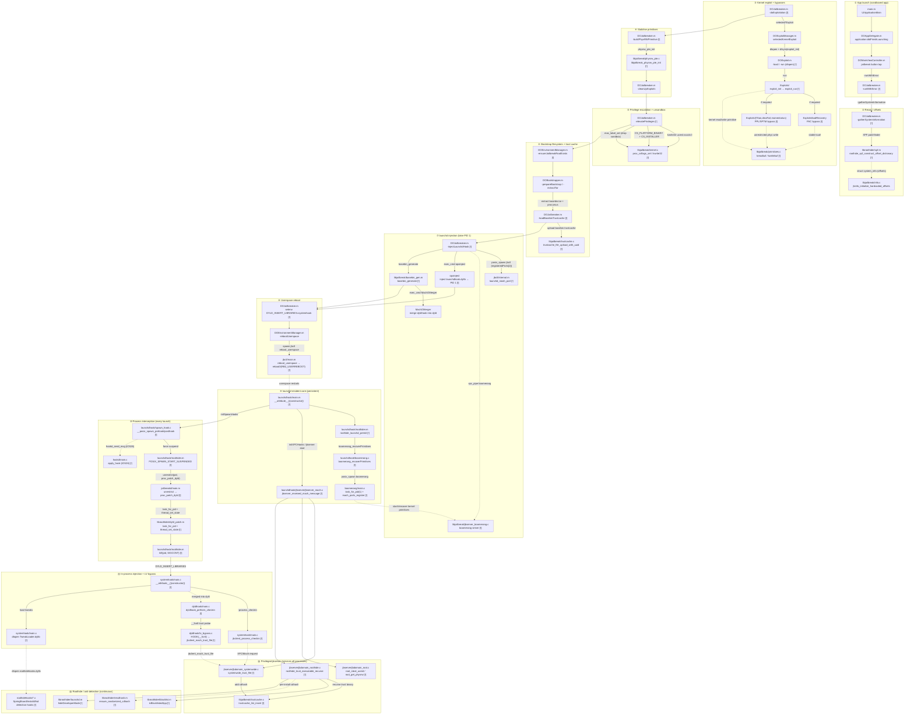

# Dopamine-roothide — Master End-to-End Flow

> Single self-contained Mermaid flowchart covering the complete execution path:
> from the user tapping the app icon, through the exploit chain and privilege
> escalation, to the components that run persistently in the background after the
> userspace reboot. Designed to be pasted directly into a SOC visualisation tool.
>
> **Legend** — solid arrow `-->` = execution flow (call / spawn / exec), labelled
> with the function or mechanism. Dashed arrow `-.->` = data / IPC / shared state,
> labelled with the channel or type. `[!]` = node invokes a suspicious / privileged
> API (kernel R/W, Mach task-port op, code-sign/trustcache subversion, dyld hook,
> suspended spawn, sandbox op, or jailbreak-detection evasion).

## Stage summary (for SOC triage)

| Stage | What happens | Primary indicators |
|-------|--------------|--------------------|
| ①–② | App launches, resolves kernel offsets | XPF patchfinder, hardcoded offsets |
| ③ | One selected exploit yields kernel R/W; optional PAC + PPL/SPTM bypass | `dlopen`+`exploit_init`, UAF/PUAF, IOKit userclients, `kread`/`kwrite` |
| ④–⑤ | Primitive stabilised; process made root + platform-trusted, sandbox dropped | `physrw_pte_init`, `kwrite32 ucred`, `CS_PLATFORM_BINARY`, `mac_label_set` |
| ⑥ | Hidden bootstrap unpacked and trust-cached | `extractTar`, `trustcache_file_upload_with_uuid` |
| ⑦–⑧ | `launchdhook` injected into PID 1 via `opainject`; `dyld` reforged; userspace reboot | `opainject`, `task_for_pid(1)`, `MachOMerger`, `reboot3(RB2_USERREBOOT)` |
| ⑨–⑩ | After reboot, launchd recovers primitives and intercepts every process launch | `boomerang_recoverPrimitives`, `POSIX_SPAWN_START_SUSPENDED`, `proc_patch_dyld`, `SIGCONT` |
| ⑪–⑫ | Each process checks in, bypasses library validation, loads tweaks; jbserver services trust/physrw requests | `jbclient_process_checkin`, `HOOK(__fcntl)`, `trust_file`, `trustcache_list_insert` |
| ⑬ | Continuous jailbreak concealment and detection evasion | `isBlacklistedApp`, `ensure_randomized_cdhash`, `hideDeveloperMode` |
